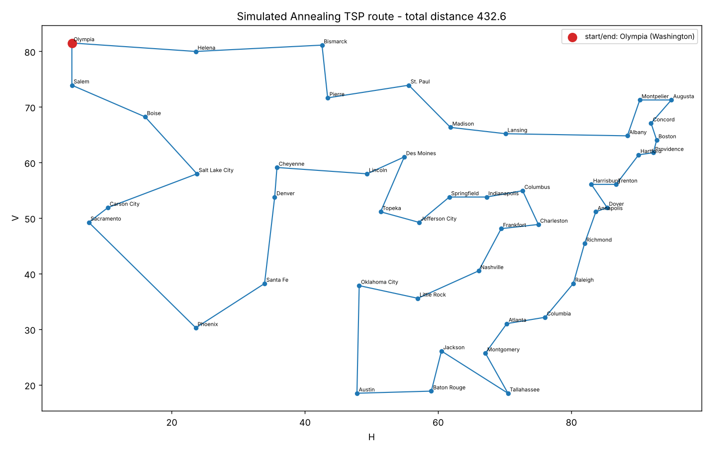

# A Walk Through the United States — Simulated Annealing TSP

A small, local command-line program that solves the *Traveling Salesman Problem*
(TSP) for the assignment **"A Walk Through the United States"** using the
**Simulated Annealing** metaheuristic.

> Propose a trip that **begins and ends in Olympia (Washington)** and visits every
> other state capital **exactly once**, minimizing the total distance travelled.

The program reads the 48 city coordinates (one capital per continental US state),
searches for a short round trip, and prints the route and total distance. It can
also draw the route as a PNG map.



## How it works

Simulated Annealing is a metaheuristic that explores tours by making small random
changes. It **always accepts** a change that shortens the tour and **sometimes
accepts** one that lengthens it — with probability `exp(-Δ / T)`. The
"temperature" `T` starts high (many bad moves accepted, so the search escapes local
minima) and is slowly cooled, so the search settles into a good tour.

- **State** — a tour; the start city (Olympia) is fixed at the front and the tour
  closes back to it, so only the other 47 cities are reordered.
- **Neighbour move** — *2-opt*: reverse a random segment of the tour. Its effect on
  the total length is computed in O(1).
- **Distance** — straight-line (Euclidean) distance between the map coordinates
  `H` (horizontal) and `V` (vertical) from the spreadsheet.

## Install

Requires Python 3.8+. The core solver uses only the standard library; the optional
extras enable the PNG map and reading the original Excel file.

```bash
pip install -r requirements.txt
```

## Usage

```bash
# Default: read data/cities.csv, start/end at Olympia, write route.png
python tsp_sa.py --seed 1

# Higher-quality (slower) search: cool more slowly, more moves per level
python tsp_sa.py --seed 1 --alpha 0.999 --iters-per-temp 400 --plot usa.png

# Text only, no image
python tsp_sa.py --seed 1 --no-plot

# Read coordinates straight from the original workbook
python tsp_sa.py --xlsx "a_walk_through_united_states.xlsx"
```

### Key parameters

| Flag | Default | Meaning |
|------|---------|---------|
| `--t-init` | auto | Initial temperature. Higher = more exploration early on. Auto-estimated from the data so ~half of random worsening moves are accepted at the start. |
| `--t-min` | `1e-3` | Stop once the temperature cools below this. |
| `--alpha` | `0.995` | Cooling factor per level (`T ← T × alpha`). Closer to 1 cools **slower** → better tours, longer runtime. |
| `--iters-per-temp` | `200` | Candidate moves tried at each temperature level. More = steadier, slower. |
| `--seed` | random | Fix the random seed for reproducible results. |
| `--start` | `Olympia (Washington)` | City that begins and ends the trip (partial name match allowed). |
| `--input` / `--xlsx` | `data/cities.csv` | Coordinate source. |
| `--plot` / `--no-plot` | `route.png` | Route-map image path, or disable it. |

**Tuning tip:** if the tour looks poor, cool more slowly (`--alpha 0.999`) and/or
raise `--iters-per-temp`. Because SA is stochastic, trying a few `--seed` values and
keeping the best run is normal practice.

## Example output

```
================================================================
Simulated Annealing TSP  -  A Walk Through the United States
================================================================
Cities loaded      : 48  (from data/cities.csv)
Start / end city   : Olympia (Washington)
Parameters         : t_init=32.01, t_min=0.001, alpha=0.995, iters_per_temp=200, seed=1
Candidate moves     : 414000  (accepted 24724)
----------------------------------------------------------------
Initial random tour: 1949.55
Best tour found    : 441.42  (77.4% shorter)
----------------------------------------------------------------
Route:
   1. Olympia (Washington)
   2. Helena (Montana)
   ...
  48. Salem (Oregon)
  49. Olympia (Washington)   (return)
================================================================
Route map written to route.png
```

Distances are in the spreadsheet's abstract map units, not miles.

## Project layout

```
tsp-simulated-annealing/
├── tsp_sa.py            # command-line entry point
├── sa/
│   ├── data.py          # load cities from CSV or the .xlsx workbook
│   ├── distance.py      # Euclidean distance matrix + round-trip tour length
│   └── annealing.py     # the simulated annealing algorithm
├── data/
│   └── cities.csv       # 48 capitals with H/V coordinates (from the Excel MAP sheet)
└── requirements.txt
```

## Data

`data/cities.csv` was extracted from the `MAP` sheet of the original
*A Walk Through the United States* workbook (columns `label, city, state, h, v`).
Pass `--xlsx <path>` to read the workbook directly instead.
